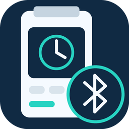

# Talento smart BLE



[](https://github.com/NickBootOne/talento-smart-ble/actions/workflows/check.yml)
[](https://github.com/NickBootOne/talento-smart-ble/actions/workflows/validate.yml)
[](https://github.com/NickBootOne/talento-smart-ble/actions/workflows/release.yml)

[Nederlandse handleiding](README.nl.md) · [Issues](https://github.com/NickBootOne/talento-smart-ble/issues) · [Releases](https://github.com/NickBootOne/talento-smart-ble/releases)

Connect a **Grässlin talento smart C15** to Home Assistant through an ESPHome Bluetooth Proxy or a local Bluetooth adapter. Current version: **2026.11.8**.

This is an independent community integration, not an official Grässlin or Home Assistant integration. You can install it as a **HACS custom repository**; it has not yet been accepted into the default HACS catalog.

## Features

- Read channel 1 relay state and operating mode, approximately every 30 seconds.
- Set FIX ON or FIX OFF and restore AUTO operation.
- Verify commands by reading the actual device state back; no optimistic switching.
- Retrieve stored schedules, with a compact dashboard overview.
- Inspect GATT services and download diagnostics.
- English and Dutch configuration and entity names, selected by Home Assistant's language settings. Backend errors currently use English.

The C15 user has confirmed physical relay operation and compared two decoded schedule entries with the official app. Long-term availability, other firmware variants and complex schedules have not been fully validated. **PIN authentication, temporary override control and schedule editing/upload are not supported.** Reading an OVR mode is not the same as controlling override.

## Requirements

- Home Assistant **2026.10.4 or newer**. This is the verified deployment baseline, not a claim that every newer version has been tested.
- A connectable ESPHome Bluetooth Proxy already added to Home Assistant, or a local Bluetooth adapter.
- Bluetooth enabled on the C15 and sufficient radio range.

For ESPHome, enable active connections:

```yaml
bluetooth_proxy:
  active: true
```

Close the official phone app and other BLE clients when using Home Assistant. Home Assistant chooses an available connectable adapter. Reconnecting after the device closes its Bluetooth window is not guaranteed and remains under investigation.

## Installation

1. In HACS, open the menu → **Custom repositories**.
2. Add `https://github.com/NickBootOne/talento-smart-ble` as an **Integration**.
3. Download and restart Home Assistant completely.
4. Open Settings → Devices & services → Add integration → **Talento smart BLE**.
5. Enter the C15 Bluetooth MAC address, not the proxy address. Find it on the device under Menu → Config → Bluetooth → Smart Link. Use `AA:BB:CC:DD:EE:FF` format.

Manual installation: copy `custom_components/talento_smart_ble` into `/config/custom_components/` and restart. Internet access is needed to install bleak-retry-connector. Setup validates the address format; it does not guarantee connectivity.

## Controls and state

| Entity | Function |
|---|---|
| Relay (FIX control) | ON sends FIX ON; OFF sends FIX OFF. State reflects the relay readback. |
| Restore AUTO | Return control to the stored schedule. AUTO does not necessarily turn the relay off. |
| Refresh channel 1 status | Request a new reading immediately. |
| Mode / Relay status | Last successfully read mode and relay state. |
| Retrieve schedule | Retrieve a schedule snapshot on demand. |
| Schedule | Number of programs and schedule attributes. |
| Inspect GATT / Last GATT inspection | Manual service inspection and its historical result. |

**FIX remains active until you restore AUTO.** The switch may display the relay state while AUTO is active, but operating it explicitly selects FIX mode. No automatic reversal is sent after a failed command. If readback fails after writing, the relay may already have changed: inspect the C15, refresh state and restore AUTO using the device or official app if necessary.

State is refreshed approximately every 30 seconds while entities are loaded and polling is enabled in the integration's system options. Read failures make the live entities unavailable. A measurement also expires after approximately two minutes without a successful refresh. Normal reads retain the previous fresh value while waiting; switching invalidates it until readback succeeds.

Updates retain unique IDs and entity IDs, including any historical words in those IDs, to avoid breaking dashboards and automations. User-assigned names are preserved. Internal relay sensor values `aan`/`uit` are retained for compatibility and translated for display.

## Schedule dashboard

1. Press **Retrieve schedule** after installation, restart or changes made in the official app.
2. Copy [the English dashboard card](examples/schedule-card.yaml), or use [the Dutch card](examples/programmering-kaart.yaml).
3. Edit your dashboard → Add card → Manual, paste the YAML and save.

The card automatically finds this integration's schedule sensors; no extra frontend plugin or entity ID is required. An integration update does not automatically insert a card into a dashboard.

The table displays program, weekdays, time, action and channel. Identical entries within one program are merged **only for presentation**. Raw packets and original counts remain in diagnostics. Their repetition has not yet been explained. The view is limited to 30 rows, with truncation indicated. It is a snapshot, not a next-switch prediction, and is not retained across HA restarts.

Schedule retrieval writes only the APK-supported **read direction 00**, then reads the packet count and content. It never uploads a program or changes the clock or relay. Transfers are limited to 90 seconds plus disconnect cleanup and share a connection lock with other operations. Unknown rules remain as raw data with warnings. Advanced pulse/cycle durations, special name encodings and some astro corrections need further validation. Astro offsets are displayed as raw signed values, not assumed to be minutes.

Protocol evidence: [status and controls (Dutch)](docs/status-protocol.md) · [program retrieval (Dutch)](docs/program-protocol.md). English summaries above describe supported behavior; detailed reverse-engineering notes are currently in Dutch.

## Diagnostics

Download diagnostics from the integration menu under Settings → Devices & services. Important sections:

- `status.measurement`: raw state, decoded mode, relay state and timestamp.
- `status.last_command`: requested command and confirmed/not_sent/unconfirmed outcome.
- `status.failure`: error stage and whether a command may already have taken effect.
- `status.freshness_reason`: never_read, fresh, expired or last_read_failed.
- `programming.snapshot`: complete schedule snapshot, raw packets, warnings and display rows.

Check files before sharing: schedules and program names can reveal personal routines. Home Assistant also adds general installation details. No PIN or authentication payload is collected by this integration.

## Development and HACS inclusion

Validation runs on relevant pushes and pull requests, weekly and on demand. HACS and Hassfest run without ignored checks. A green custom test workflow alone is not HACS approval. The catalog submission has not been made yet.

Run isolated tests: `python -m unittest discover -s tests -v`. These use fake Bluetooth/HA dependencies, not a full Home Assistant runtime. Hardware verification and runtime coverage are tracked in issues.

Versions follow **YEAR.MONTH.RELEASE_NUMBER**, for example 2026.11.8. The final number is the release sequence within the month, not the day. Update manifest, diagnostics and README, validate, then push the matching tag (`v2026.11.8`). The release workflow tests and publishes a GitHub release. HACS detects releases periodically; automatic installation/restarting requires a separately configured local automation.

The code and original project icon are distributed under the [MIT License](LICENSE). Third-party dependencies retain their own licenses. Proprietary APKs, extracted assemblies and private diagnostic captures are not distributed in this repository.

To remove: delete the config entry in Devices & services, uninstall via HACS (or remove the integration folder), then restart Home Assistant.
